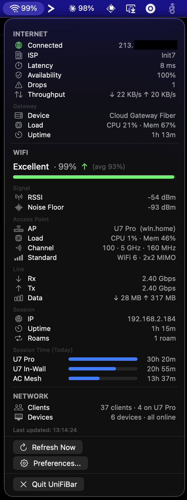

<div align="center">


# UniFiBar

**Real-time UniFi WiFi monitoring in your macOS menu bar.**

Monitor WiFi signal strength, latency, throughput, roaming, and network health — all from your menu bar. Built for Ubiquiti UniFi users who want instant visibility into their wireless connection.

[](https://swift.org)
[](https://developer.apple.com/macos/)
[](LICENSE)



</div>

## Features

- **WiFi Experience Score** — real-time satisfaction percentage with trend indicators
- **Signal Monitoring** — RSSI, noise floor, and signal quality trends
- **Access Point Details** — current AP, channel, WiFi standard, MIMO configuration
- **Link Speeds** — Rx/Tx rates, session data transfer totals
- **Roaming Detection** — alerts when your Mac switches between access points
- **Internet Health** — WAN status, ISP name, latency, availability, packet drops
- **Gateway Monitoring** — CPU, memory, uptime of your UniFi gateway
- **WAN Throughput** — real-time upload/download speeds
- **VPN Tunnels** — configured site-to-site tunnels; absent live status is shown as unknown (not client VPN apps)
- **Network Overview** — total clients, devices online/offline, firmware updates
- **Session History** — daily roaming breakdown by access point
- **Launch at Login** — optional autostart via macOS login items
- **Self-Signed Certificates** — works with custom SSL setups

## Supported Hardware

Tested with **Ubiquiti UniFi** network equipment:

- **Gateways**: Cloud Gateway Fiber (UCG Fiber), UniFi Dream Machine (UDM), UDM Pro, UDR, UXG
- **Access Points**: U7 Pro, U7 In-Wall, U6, AC Mesh, and all UniFi APs
- **Requires**: UniFi Network Application 10.1.85+ with API key support

## Requirements

- macOS 26 (Tahoe) or macOS 27 (Golden Gate)
- Xcode 26 or 27 command line tools (Swift 6.2+)
- A UniFi API key (Settings → Integrations → Generate API Key)

## Build & Install

```bash
git clone https://github.com/darox/UniFiBar.git
cd UniFiBar
Scripts/package_app.sh
cp -r .build/release/UniFiBar.app /Applications/
open /Applications/UniFiBar.app
```

For development:

```bash
Scripts/compile_and_run.sh
```

For test commands, worktree setup, and macOS QA, read
[Development checks](docs/development.md).

## Setup

1. Open UniFiBar from the menu bar
2. Enter your UniFi controller URL (e.g. `https://192.168.1.1`)
3. Paste your API key (generate in UniFi → Settings → Integrations)
4. Enable "Allow self-signed certificates" if needed
   - If the factory certificate does not name your controller's IP, UniFiBar asks
     you to verify its SHA-256 fingerprint and explicitly **Trust Certificate**.
     The public key is then pinned for that address; expired certificates and
     changed keys remain blocked. Background polling never approves new keys.
5. UniFiBar automatically detects your Mac on the network and starts monitoring

## How It Works

UniFiBar connects to your UniFi controller's API and identifies your Mac by matching its local IP address against active clients. It polls every 30 seconds for updated metrics and reacts instantly to network changes and wake-from-sleep events.

**Data sources:**
- Official UniFi Integration API — devices, sites, statistics, VPN tunnels
- UniFi v2 and legacy APIs — active clients, WAN health, session history, optional monitoring

Credentials are stored in the macOS Keychain. Monitoring requests go to your
configured controller; update checks contact GitHub. Diagnostics remain local
unless you copy and share them. Copied reports omit identifiers and free-text
details by default. Preferences offers a one-copy opt-in to include private
details; review that report for secrets before sharing.

Upgrading from the old two-item credential format requires entering your controller
URL and API key again. New saves keep the URL, key and certificate mode together.
Reset disables automatic reconnection and reports incomplete cleanup rather than
claiming that inaccessible Keychain entries were removed.
Missing-entitlement errors require an appropriately signed build with access
to the original records, not repeated unlock attempts.

Site selection uses the default site when present, otherwise the single visible
site. Multiple sites without a default are rejected rather than mixed. Official
and older API requests use the same site's paired identifiers. Official lists
are paginated within limits; failed, empty and refreshing optional data are
distinguished in the menu. Large or incompatible responses show errors rather
than silently truncated totals. Channel numbers are shown without guessing a
frequency band. Supported-controller replay and native release QA are still
required; see [development checks](docs/development.md).

## Tech Stack

- **Swift 6** with strict concurrency
- **SwiftUI** with Liquid Glass materials (macOS 26 and 27)
- **SwiftPM** — no Xcode project required
- **async/await** with actor isolation for thread safety

## License

MIT
