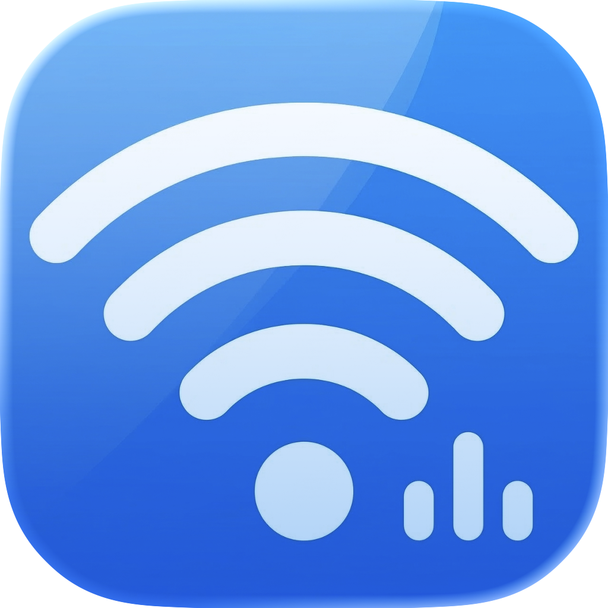

<div align="center">



# UniFiBar

**Real-time UniFi WiFi monitoring in your macOS menu bar.**

Monitor WiFi signal strength, latency, throughput, roaming, and network health from the menu bar. Built for Ubiquiti UniFi users who want instant visibility into their wireless connection.

[](https://swift.org)
[](https://developer.apple.com/macos/)
[](LICENSE)

</div>

## Features

- **WiFi Experience Score.** Real-time satisfaction percentage with trend indicators
- **Signal Monitoring.** RSSI, noise floor, and signal quality trends
- **Access Point Details.** Current AP, channel, WiFi standard, MIMO configuration
- **Link Speeds.** Rx/Tx rates, session data transfer totals
- **Roaming Detection.** Alerts when your Mac switches between access points
- **Internet Health.** WAN status, ISP name, latency, availability, packet drops
- **Gateway Monitoring.** CPU, memory, uptime of your UniFi gateway
- **WAN Throughput.** Real-time upload/download speeds
- **VPN Tunnels.** Configured site-to-site tunnels; absent live status is shown as unknown (not client VPN apps)
- **Network Overview.** Total clients, devices online/offline, firmware updates
- **Session History.** Daily roaming breakdown by access point
- **Launch at Login.** Optional autostart via macOS login items
- **Self-Signed Certificates.** Works with custom SSL setups

## Supported Hardware

Tested with **Ubiquiti UniFi** network equipment:

- **Gateways**: Cloud Gateway Fiber (UCG Fiber), UniFi Dream Machine (UDM), UDM Pro, UDR, UXG
- **Access Points**: U7 Pro, U7 In-Wall, U6, AC Mesh, and all UniFi APs
- **Requires**: a UniFi Network Application release that exposes the official
  Network Integration API and API keys (verified against 10.4.57, see
  [the API contract notes](docs/unifi-api-contracts-2026-09-08.md))

## Requirements

- macOS 26 (Tahoe) or macOS 27 (Golden Gate)
- Xcode 26 or 27 command line tools (Swift 6.2+)
- A UniFi API key (Settings → Integrations → Generate API Key)

Last verified on macOS 26 with Xcode 26 and on macOS 27.2 with Xcode 27.1.
CI builds and tests both the macOS 26 and the Xcode 27 preview images.

## Install

Download the [latest release](https://github.com/darox/UniFiBar/releases/latest), unzip it, and move `UniFiBar.app` to Applications.
The build carries a Developer ID signature and an Apple notarization ticket.

To build from source:

```bash
git clone https://github.com/darox/UniFiBar.git
cd UniFiBar
Scripts/package_app.sh
cp -r .build/release/UniFiBar.app /Applications/
open /Applications/UniFiBar.app
```

For development:

```bash
Scripts/compile_and_run.sh
```

For test commands, worktree setup, and macOS QA, read
[Development checks](docs/development.md).

## Setup

1. Open UniFiBar from the menu bar
2. Enter your UniFi controller URL (e.g. `https://192.168.1.1`)
3. Paste your API key (generate in UniFi → Settings → Integrations)
4. Enable "Allow self-signed certificates" if needed
   - If the factory certificate does not name your controller's IP, UniFiBar asks
     you to verify its SHA-256 fingerprint and explicitly **Trust Certificate**.
     The public key is then pinned for that address; expired certificates and
     changed keys remain blocked. Background polling never approves new keys.
5. UniFiBar automatically detects your Mac on the network and starts monitoring

## How It Works

UniFiBar matches your Mac's local IP address against the controller's active clients. It polls every 30 seconds by default, configurable from 10 to 300 seconds, and backs off up to 300 seconds after a failed poll. Network changes and wake-from-sleep trigger an immediate refresh.

**Data sources:**
- Official UniFi Integration API: devices, sites, statistics, VPN tunnels
- UniFi v2 and legacy APIs: active clients, WAN health, session history, optional monitoring

Credentials are stored in the macOS Keychain. Monitoring requests go to your
controller and update checks go to GitHub. Diagnostics stay local until you copy
them, and copied reports omit identifiers by default.

UniFiBar uses the default site, or the only visible site. Multiple sites without
a default are rejected.

Upgrading from the old two-item credential format requires entering your controller
URL and API key again.

## Tech Stack

- **Swift 6** with strict concurrency
- **SwiftUI** with Liquid Glass materials (macOS 26 and 27)
- **SwiftPM** with no Xcode project required
- **async/await** with actor isolation for thread safety

## Security

Read the [security policy](SECURITY.md) for reporting instructions
and supported versions.

## License

MIT
